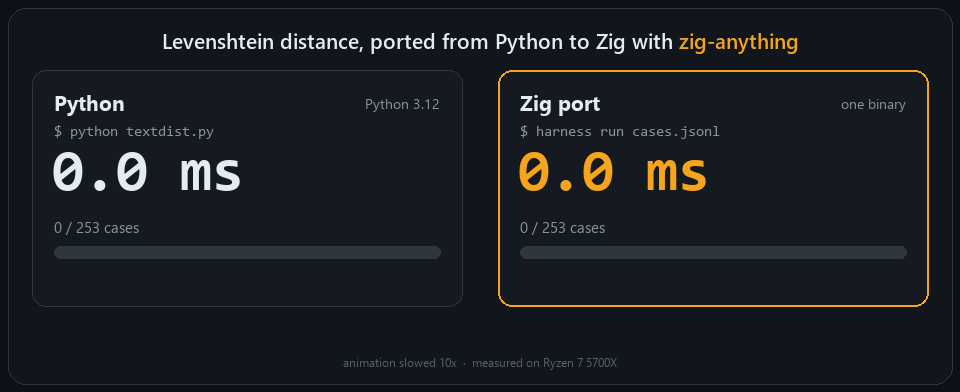
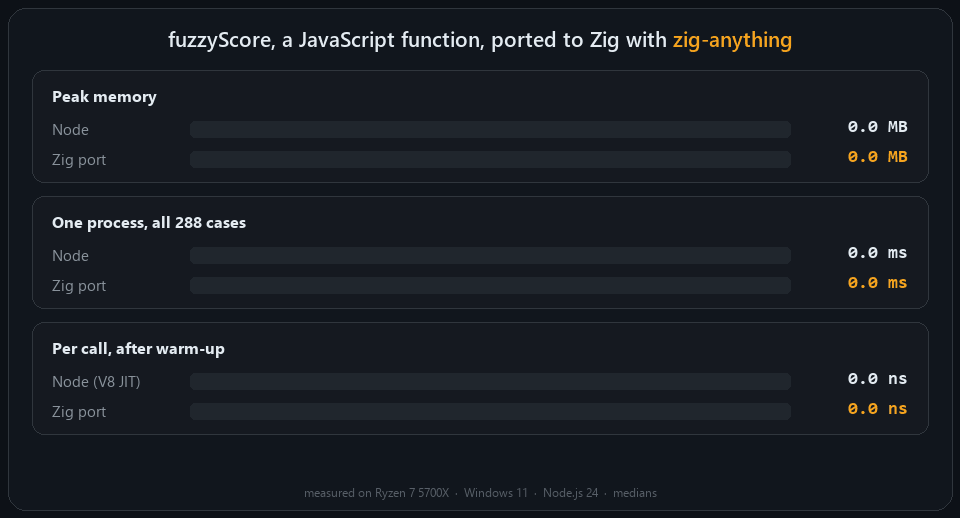

<p align="center">
  
</p>

<h1 align="center">zig-anything</h1>

<p align="center">
  <strong>Port JavaScript, TypeScript and Python functions, and whole command-line programs, to Zig one piece at a time, and prove every port behaves exactly like the original.</strong>
</p>

<p align="center">
  <a href="https://github.com/Layfate/zig-anything/actions/workflows/ci.yml"></a>
  
  
</p>

<p align="center">
  
  <br>
  <sub>Measured with <code>zig-anything bench</code> on <a href="examples/levenshtein-py">examples/levenshtein-py</a>. Regenerate with <code>python scripts/make_demo_gif.py</code>.</sub>
</p>

zig-anything records what a function in your existing code actually does (on generated edge cases, semantic traps and inputs you supply), scaffolds a Zig port of it, and replays every recorded case against the port until they all match. A single command, `gate`, decides when a port is done.

```text
$ zig-anything diff fuzzyScore
case 22: different value
  args      ["🎉","emoji 🎉 ok"]
  expected  {"ok":0.75}
  got       {"ok":0.7}
285/288 cases match  [zig-port/fuzzyScore]
```

*That mismatch is real: the first Zig port counted bytes, but JavaScript counts UTF-16 code units. The recording caught it.*

- **One static binary**, about 0.75–1.1 MB, with no runtime dependencies. Written in Zig with only the standard library. Also on npm and PyPI.
- **Language-agnostic replay.** The original runs in its own runtime (Node or Python) through a small embedded recorder. The port runs as a native Zig harness. Results meet as JSON lines.
- **Semantic comparison.** `1`, `1.0` and `1e0` are equal, object key order is ignored, and NaN/±Infinity survive the round trip. Thrown errors match returned Zig errors. Optionally, argument mutation and printed output are compared too.
- **Whole-project migrations.** `plan` orders a project's functions (callees first, hot code first), `fuzz` finds inputs the recording missed, and `integrate` switches callers to a proven port with verification and automatic rollback.
- **Fast native bridge.** A finished port is callable from Node through a Node-API addon (TypedArrays without copying, WebAssembly fallback) and from Python through `ctypes`.
- **Measured, not claimed.** `bench` times both sides on the same recorded inputs and reports a verdict, including when the port is *slower*.
- **Agent-ready.** `zig-anything mcp` exposes every command as a Model Context Protocol tool with compact results, and `setup-agent` registers it with Claude Code, Cursor and VS Code.

## Contents

- [Benchmarks](#benchmarks)
- [Install](#install)
- [Quick start](#quick-start)
- [Commands](#commands)
- [How it works](#how-it-works)
- [Migrating a whole project](#migrating-a-whole-project)
- [Calling the port from your code](#calling-the-port-from-your-code)
- [Porting whole programs](#porting-whole-programs)
- [Writing a port](#writing-a-port)
- [Configuration](#configuration)
- [MCP server](#mcp-server)
- [Scope and limitations](#scope-and-limitations)
- [Building from source](#building-from-source)
- [Contributing](#contributing) · [Changelog](CHANGELOG.md) · [License](#license)

## Benchmarks

<p align="center">
  
  <br>
  <sub>Memory and one-process time: <code>python bench/peakmem.py --runs 15 -- &lt;command&gt;</code>, running the recorder and the Zig harness directly. Per call: <code>zig-anything bench fuzzyScore</code>. Regenerate with <code>python scripts/make_bars_gif.py</code>.</sub>
</p>

All numbers below were measured on one machine: AMD Ryzen 7 5700X, 32 GB RAM, Windows 11, Zig 0.17.1, Node.js 24.21, Python 3.12.10. Each row is a median of 5 runs. Reproduce them with the commands shown; your numbers will differ.

**Example ports** (`zig-anything bench <unit>`):

| Unit | Original | Per call: original | Per call: Zig | Per call: speedup | One process, all cases: original | One process, all cases: Zig |
| --- | --- | --- | --- | --- | --- | --- |
| [`levenshtein`](examples/levenshtein-py) | Python 3.12 | 51.1 µs | 0.31 µs | **164x** | 134.6 ms | 6.5 ms |
| [`fuzzyScore`](examples/fuzzy-js) | Node.js 24 (V8 JIT) | 61.3 ns | 32.5 ns | **1.9x** | 43.6 ms | 6.9 ms |
| `wc` ([program unit](#porting-whole-programs), test fixture) | Python 3.12 | — | — | — | 92.9 ms per run | 6.1 ms per run |

"Per call" excludes runtime startup: both sides parse the inputs first, run one untimed warm-up pass, then run calibrated timed passes. "One process" is wall time for a fresh process that loads the code and runs every case once. Cases that throw are excluded from benchmarks, because exceptions cost much more in most runtimes than errors in Zig, and that would flatter the port.

A JIT is a strong baseline. The first `fuzzyScore` port matched every case but ran 2.6x *slower* than V8 (164 ns per call), because it converted both strings to UTF-16 buffers on every call. Profiling showed the conversion, not allocation, was the cost. JavaScript knows string lengths in O(1), while the port scanned whole strings to learn them. The final port streams UTF-16 units straight from the UTF-8 input, with an inline ASCII fast path, and drops the redundant length check. That brought it to 31.6 ns. The recorded cases stayed 288/288 green throughout, which is what made the rewrite safe. The story is in [examples/fuzzy-js](examples/fuzzy-js).

**The workflow**, when nothing changed since the last run (the common case in an edit, diff, edit loop). Median of 9 interleaved runs, with the interquartile range; `python bench/e2e.py --baseline v0.1.1 --runs 9`:

| Command | v0.1.1 | Now |
| --- | --- | --- |
| `diff fuzzyScore` | 142.8 ms [140–153] | 20.0 ms [20–21] |
| `gate fuzzyScore` | 267.8 ms [267–274] | 23.7 ms [23–25] |
| `record fuzzyScore` (Node) | 95.4 ms [93–101] | 58.6 ms [58–62] |
| `diff levenshtein` | 141.6 ms [140–144] | 20.5 ms [20–21] |
| `gate levenshtein` | 272.5 ms [268–290] | 24.1 ms [23–25] |
| `record levenshtein` (Python) | 305.9 ms [300–311] | 175.7 ms [174–187] |

Most of the gain is the build cache (`diff` and `gate` no longer run `zig build` when nothing it reads changed); `record` gains from running its two verification runs in parallel.

**The tool itself**:

| Measurement | Result | Reproduce |
| --- | --- | --- |
| binary size, size-optimized, x86_64 Linux / macOS / Windows | 760 KB / 732 KB / 1,068 KB | `zig build release` |
| startup, `zig-anything --version` (Windows, includes process creation) | 4.1 ms median | `python bench/startup.py -- zig-out/bin/zig-anything --version` |
| peak memory of a port harness running 288 cases (`fuzzyScore`) | 4.1 MB, vs 47.2 MB for Node running the original | `python bench/peakmem.py -- <command>` |
| scan JavaScript | 137 MiB/s | `zig build microbench` |
| scan Python | 200 MiB/s | `zig build microbench` |
| parse and compare 100,000 recorded cases | 228 ms (70 MiB/s) | `zig build microbench` |
| generate 1,000 random cases for 3 parameters | 0.30 ms | `zig build microbench` |

## Install

**npm or pip.** Both packages contain the same prebuilt binary and nothing else:

```sh
npm install --save-dev zig-anything     # then: npx zig-anything ...
pip install zig-anything                # then: zig-anything ...
```

**Prebuilt binaries.** Download the archive for your platform from the [releases page](https://github.com/Layfate/zig-anything/releases). Builds exist for Linux (x86_64, aarch64; static musl), macOS (x86_64, Apple Silicon) and Windows (x86_64, aarch64). Put `zig-anything` on your `PATH`.

**From source** (needs [Zig 0.17.1](https://ziglang.org/download/)):

```sh
git clone https://github.com/Layfate/zig-anything
cd zig-anything
zig build -Doptimize=fast
# binary: zig-out/bin/zig-anything
```

**Runtime requirements.** These are needed only for the commands that use them:

| Needed for | Tool |
| --- | --- |
| building and diffing ports | `zig` 0.17.1 on `PATH` (or `ZIG=/path/to/zig`) |
| recording JavaScript | Node.js 22.6+ |
| recording TypeScript | Node.js 23.6+ (native type stripping), or a loader configured in [`node`](#configuration) |
| recording Python | Python 3.8+ |

## Quick start

This walks through the [`examples/fuzzy-js`](examples/fuzzy-js) project.

```sh
cd examples/fuzzy-js

# 1. Find candidates: top-level functions with inferred parameter types.
zig-anything scan src
#   src/fuzzy.mjs  (javascript)
#         7  fuzzyScore(query: string, text: string)

# 2. Scaffold a port unit: manifest, Zig stub, harness and build files.
zig-anything init src/fuzzy.mjs fuzzyScore

# 3. Record the original's behavior on edge cases plus your own inputs.
zig-anything record fuzzyScore
#   recorded 288 cases -> zig-port/fuzzyScore/cases.jsonl
#     returned  288  (number 288)

# 4. Write zig-port/fuzzyScore/src/port.zig, then compare. Repeat until green.
zig-anything diff fuzzyScore
#   288/288 cases match

# 5. Done means this passes (exit code 0).
zig-anything gate fuzzyScore
#   [ok]   manifest       fuzzyScore
#   [ok]   port written   no TODO marker
#   [ok]   cases recorded 288 deterministic case(s)
#   [ok]   builds         -Doptimize=safe
#   [ok]   port tests     zig build test
#   [ok]   behavior       288/288 cases match
#   PASSED: fuzzyScore is a faithful port

# 6. Is it faster?
zig-anything bench fuzzyScore

# 7. Switch the original's callers to the port: verified, rolled back on failure.
zig-anything integrate fuzzyScore -- npm test
```

`zig-anything status` lists every unit in the project with its state (`stub`, `unrecorded`, `untested`, `failing`, `stale` or `passing`), its last diff and its speedup.

> **Safety:** `record` and `bench` **run your original code**, once or more per case. If it writes files, talks to a database or calls the network, it will do so. Record pure functions, or run on a copy with test credentials.

## Commands

| Command | What it does |
| --- | --- |
| `profile <script> [-- args]` | Run a JS/TS/Python script under its runtime's profiler (`node --cpu-prof`, `cProfile`), rank your functions by time and mark the portable ones. `--top N`, `--all`, `--json`. |
| `scan [path]` | List top-level functions in a file or project, with inferred parameter and return types. `--all` includes non-exported functions; `--json` gives machine-readable output. |
| `plan [path]` | Order a [whole project's migration](#migrating-a-whole-project): callees before callers, then by time. Flags blockers (async, I/O, randomness, shared state) and gives each step's next command. `--hot FILE` (from `profile --json`), `--limit N`, `--all`, `--json`. |
| `init <file> <function>` | Create a port unit (default `zig-port/<function>/`). `--out DIR` chooses the directory. `--force` regenerates the manifest and harness; your `port.zig` and `build.zig` are never overwritten. |
| `record <unit>` | Run the original on generated cases plus `inputs.jsonl` (and `inputs.fuzz.jsonl`), twice, and write `cases.jsonl` and `recording.json`. Cases whose results differ between the two runs are marked flaky and skipped by `diff`. Flags: `--samples N`, `--seed N`, `--max-cases N`, `--no-verify`, `--no-generate`, `--effects` (also record argument mutation and printed output), `--sandbox` (block file writes, subprocesses and network), `--check` (fail if re-recording would change anything; writes nothing), `--jobs N`. |
| `fuzz <unit>` | Mutate recorded inputs and keep the ones that reach new code in the original, in `inputs.fuzz.jsonl` for the next `record`. `--rounds N`, `--batch N`, `--seed N`, `--max-new N`, `--sandbox`, `--json`. |
| `build <unit>` | Compile the port and harness. `--optimize debug\|safe\|fast\|small` (default `safe`). Skipped when nothing it reads changed. |
| `diff <unit>` | Build, replay every case, and report mismatches with arguments, expected and actual results. A crash or hang is reported on its case and the rest still run. Flags: `--tolerance X`, `--strict-errors`, `--limit N`, `--case 3,17`, `--effects`, `--jobs N`, `--no-build`, `--json`. |
| `bench <unit>` | Time the original against the port (built with `-Doptimize=fast`) on the recorded inputs and give a verdict. Flags: `--runs N`, `--target-ms MS`, `--json`. |
| `gate <unit>` | Every check must pass: port written, cases recorded, builds, `zig build test` passes, every case matches. `--bench` also requires the port to be at least as fast. |
| `status [dir]` | Overview of all units, including which are integrated. `--json` is available. |
| `bridge <unit>` | Make a finished port callable from the original code: a native Node-API addon + WebAssembly + `index.mjs` (+ `index.d.ts`) for JS/TS, a native library + `port.py` for Python. Replays every recorded case through every backend. `--optimize MODE`, `--no-native`, `--no-verify`. |
| `integrate <unit> [-- test command]` | Rewrite the original source so callers run the port, verify through the rewritten file (and your tests), and roll back automatically on failure. `--dry-run`, `--rollback`, `--force`, `--no-native`. |
| `init-cli <name> -- <command...>` | Create a [program unit](#porting-whole-programs) for a whole command-line program in any language. `--cwd DIR`, `--out DIR`, `--force`. |
| `setup-agent` | Register the MCP server with Claude Code (`.mcp.json`), Cursor and VS Code in this project, merging with existing configuration. `--client NAME`, `--agents-md`, `--dry-run`. |
| `mcp` | Serve the commands as MCP tools over stdio. `--print-config` prints a registration snippet. |

Global flags: `--no-color`, `--color`, `--no-cache` (always run the compiler).

A `<unit>` is a unit directory (`zig-port/slugify`) or just its name (`slugify`), which is looked up in the configured units directory.

**Exit codes:** `0` success · `1` a check failed (mismatches, compile errors, gate) · `2` usage error · `3` runtime or environment error (missing tool, unreadable file).

Every command has `--help`. Typos in commands and flags get suggestions.

## How it works

```text
             ┌──────────── record ────────────┐            ┌──────────── diff ─────────────┐
 inputs.jsonl ─┐                               │            │                               │
 generated   ──┼─► args ─► node/python recorder ─► cases.jsonl ─► zig harness ─► port.zig     │
 edge cases  ──┘          (embedded script)    │   (args +  │   (generic,      (your code)  │
                                               │   expected)│    comptime)                  │
             └─────────────────────────────────┘            └──► semantic compare ─► report ┘
```

A **port unit** is a directory:

```text
zig-port/fuzzyScore/
├── unit.json        what is being ported and from where (source path, params, types)
├── cases.jsonl      recorded behavior; commit it, it is the spec
├── inputs.jsonl     optional hand-written inputs, one argument array per line
├── build.zig        generated once; extend freely
└── src/
    ├── port.zig     the port: yours to write
    ├── harness.zig  generated: feeds cases to the port
    └── rt.zig       generated: JSON ⇄ Zig conversion
```

**Input generation.** Each parameter type has a pool of edge values and semantic traps:

- numbers: `0`, `-1`, `0.5`, `1e-9`, `2^31-1`, `2^53`, `0.1`, `NaN`, `±Infinity`
- strings: empty, whitespace, `"null"`, `"0"`, newlines, tabs, accents, CJK, emoji, a 300-character string, quotes and backslashes
- arrays: empty, singleton, unsorted, duplicates

Every parameter is driven through its whole pool while the others hold typical values. Then seeded random combinations are added. Recordings are reproducible: the same seed gives the same `cases.jsonl` byte for byte, and an unchanged recording is not rewritten.

**Type inference.** Parameter types come from TypeScript annotations, Python annotations and default values. When those are missing, they come from how the body uses the parameter: `x.toLowerCase()` means a string, `x * 2` or `Math.min(x, …)` a number, `range(n)` or `n // 2` an int. Parameter names are the last resort (`isEnabled` → bool, `count` → int). Inference only shapes the generated inputs and the stub signature, and you can override both.

**Comparison rules** (`diff`):

| Situation | Result |
| --- | --- |
| both returned values | match if semantically equal: numbers by value (`--tolerance` for floats), objects ignoring key order, arrays element by element. JavaScript integers compare as doubles (as JavaScript stores them); Python integers compare exactly |
| original threw, port returned an error | match (`--strict-errors` also requires equal names, e.g. `error.RangeError` for a `RangeError`) |
| one threw, the other did not | mismatch |
| recorded with `--effects` | the arguments after the call and the printed output must match too |
| port crashed or hung | mismatch on that case; the harness restarts after it and the remaining cases still run |
| result flaky across the two recording runs | skipped and reported |

**Value encoding.** Results travel as JSON. Non-finite floats are written as `{"$num":"NaN"}`, `{"$num":"Infinity"}` or `{"$num":"-Infinity"}`. `undefined` becomes `null`. `Map` and `Set` become objects and arrays, `Date` an ISO string, and Python tuples become arrays. Values JSON cannot carry (functions, symbols, BigInt) are flagged by `record`.

More detail is in [docs/ARCHITECTURE.md](docs/ARCHITECTURE.md).

## Migrating a whole project

```text
$ cd tests/fixtures
$ zig-anything plan .            # add --hot hot.json (from `profile --json`) for a TIME column
migration plan for .: 13 function(s) in 6 file(s); 0 done, 10 ready, 3 to review, 0 blocked

  #  FUNCTION         WHERE                WAVE   TIME LINES  STATE    NOTES
  1  clamp            js/textutil.mjs:10      0      -     1  ready
  2  count            cli/wc.py:5             0      -     2  ready
  ...
 11  saveNote         js/vec.mjs:10           0      -     4  review   untyped parameter (std.json.Value); file I/O
 12  save_note        py/effects.py:4         0      -     4  review   file I/O
 13  main             cli/wc.py:9             1      -    26  review   untyped parameter (std.json.Value); file I/O; prints (record with --effects); reads process state; calls count

next: zig-anything init js/textutil.mjs clamp
```

`plan` puts every function after the project functions it calls (wave 0 calls none of them), so each port can be finished, bridged and integrated on its own while the rest of the code keeps running. Within a wave, hot functions come first when you pass `--hot hot.json`, then ready ones, then small ones. Functions that are async or variadic are `blocked` (wrap them in a synchronous function first). Those with untyped parameters, I/O, clock reads, randomness or shared state are marked `review`: record them with `--sandbox` or `--effects`, or wrap them. Existing units show their state, and the plan gives the next command for each step.

Then, per function:

```sh
zig-anything init src/text.mjs normalize
zig-anything record normalize
zig-anything fuzz normalize && zig-anything record normalize   # inputs that reach new code
# write zig-port/normalize/src/port.zig until `diff` is green
zig-anything gate normalize
zig-anything integrate normalize -- npm test
```

`integrate` builds and verifies the bridge, backs up the source file (`zig-port/normalize/integration/`) and rewrites it. In an ES module, the function's name is imported from the bridge and the original is kept as `normalize__original`. In Python, the name is rebound right after the original's definition. It then replays every recorded case through the rewritten file and runs the command after `--`. If either fails, it restores the file byte for byte. `zig-anything integrate --rollback normalize` undoes it later. It refuses if the file changed since integrating, unless you pass `--force`. `--dry-run` shows the rewrite first. CommonJS files are not rewritten, because the bridge is an ES module.

## Calling the port from your code

`zig-anything bridge <unit>` turns a passing port into something the original code can import today, without waiting for the rest of the migration:

```js
// JavaScript / TypeScript: a native Node-API addon, with a WebAssembly fallback
import { fuzzyScore, fuzzyScoreBatch, backend } from './zig-port/fuzzyScore/bridge/index.mjs';
```

```python
# Python: a native library loaded with the standard library's ctypes.
# `zig-anything bridge` prints the exact import snippet for your source file.
levenshtein = _mod.levenshtein   # from zig-port/levenshtein/bridge/port.py
```

The bindings keep the original name and parameters, raise matching exceptions (`RangeError`, `ValueError`, …) for errors the port returns, copy in-place changes to array arguments back to the caller, and are verified: `bridge` replays every recorded case through them, through every backend.

**Node: native addon first.** `bridge` builds `port.node`, a Node-API addon for the current platform, next to the portable `port.wasm`. The addon converts arguments straight to the port's Zig types, with no JSON. A `Float64Array` (or another TypedArray whose element type matches a numeric slice parameter) is passed to the port without copying. It needs no Node headers, node-gyp or compiler other than Zig. `index.mjs` loads the addon when it can and falls back to WebAssembly otherwise. `backend` tells you which one is in use, and `ZIG_ANYTHING_BRIDGE=wasm` forces WebAssembly. The addon is built for the machine that runs `bridge`, so build it where the code runs (or rely on the fallback). **Python** loads a native library with `ctypes`, and calls cross as JSON.

Per-call cost on the examples, including the call from the original language, measured with the same harness for every row (`python bench/e2e.py`; same machine as [Benchmarks](#benchmarks)):

| | Original | Native addon | WebAssembly | `ctypes` |
| --- | --- | --- | --- | --- |
| `fuzzyScore`, Node.js | 69 ns | 145 ns | 1,806 ns | — |
| `levenshtein`, Python | 48.4 µs | — | — | 6.8 µs (7x faster) |

The native addon has about a twelfth of the WebAssembly overhead, but a 70 ns function in a JIT is still cheaper to call in place than through any crossing. The bridge pays off when the function does real work. Otherwise port its caller too, or call it in batches (`…Batch` / `…_batch` cross once for many calls). `bridge` warns when `bench` shows this.

## Porting whole programs

A program unit ports an entire command-line program, written in any language, by recording invocations instead of function calls:

```sh
zig-anything init-cli wc --cwd tools -- python wc.py
# edit zig-port/wc/inputs.jsonl: one invocation per line, e.g.
#   ["-l", "notes.txt"]
#   {"args": ["-w"], "stdin": "some text"}
zig-anything record wc         # stdout, stderr and exit code of each run
# write zig-port/wc/src/main.zig
zig-anything diff wc           # compares stdout and exit code per invocation
zig-anything gate wc
zig-anything bench wc          # whole-process time, startup included
```

Both programs run from the same working directory. Line endings are normalized unless you pass `--exact-newlines`, and `--compare-stderr` also compares stderr.

## Writing a port

The stub `init` writes looks like this:

```zig
// TODO(zig-anything): port this function, then delete this line.
pub fn slugify(allocator: std.mem.Allocator, text: []const u8) ![]const u8 {
    ...
}
```

- **Any signature works.** The harness reads your function's parameter types at compile time and decodes each recorded argument into them. Supported types: `bool`, integers, floats, `[]const u8`, slices of any supported type, optionals, structs (from JSON objects), enums (from strings) and `std.json.Value`.
- **Allocation is free.** A `std.mem.Allocator` parameter receives a per-call arena that is reset after every call. Remove the parameter if you don't need it.
- **Throws become errors.** Return an error wherever the original throws or raises.
- **Return anything encodable**: the same types as parameters, plus tuples and fixed arrays.
- **Delete the TODO marker.** `gate` refuses a port that still carries it.
- **`port.zig` is plain Zig.** The unit's `build.zig` exposes it as the module `port`, so a Zig program can depend on it directly once the migration is complete.

Inferred types map like this: `number` → `f64`, `int` → `i64`, `string` → `[]const u8`, `bool` → `bool`, `number_array` → `[]const f64`, `int_array` → `[]const i64`, `string_array` → `[]const []const u8`, and anything else → `std.json.Value`.

## Configuration

Configuration is optional. zig-anything looks for a `zig-anything.json` in the current directory or the unit's directory, then in each parent directory. Unknown fields are rejected, so typos surface immediately.

```json
{
  "units_dir": "zig-port",
  "node": ["node"],
  "python": ["python3"],
  "zig": "zig",
  "samples": 64,
  "seed": 1,
  "max_cases": 2000,
  "timeout": 300,
  "tolerance": 0,
  "jobs": 0,
  "cache": true,
  "effects": false,
  "sandbox": false,
  "env": { "TZ": "UTC" }
}
```

| Field | Meaning |
| --- | --- |
| `units_dir` | where `init` puts units, relative to the config file |
| `node`, `python` | command plus leading arguments used to run the original, e.g. `["node", "--import", "tsx"]` for TypeScript that needs a loader |
| `zig` | compiler used to build units |
| `samples`, `seed`, `max_cases` | case generation |
| `timeout` | seconds before any child process is stopped |
| `tolerance` | default float tolerance for `diff` |
| `jobs` | parallel processes for recording and replay (0 = one per CPU core) |
| `cache` | skip `zig build` when nothing it reads changed (`--no-cache` overrides) |
| `effects`, `sandbox` | defaults for `record --effects` and `record --sandbox` |
| `env` | extra environment variables for the original, e.g. a fixed `TZ` |

Environment overrides: `ZIG_ANYTHING_NODE`, `ZIG_ANYTHING_PYTHON`, `ZIG`, `NO_COLOR`. Run `zig-anything help config` to see the defaults for your platform.

## MCP server

`zig-anything mcp` speaks the Model Context Protocol over stdio. It exposes fourteen tools, one per command: `zig_anything_profile`, `_scan`, `_plan`, `_init`, `_init_cli`, `_record`, `_fuzz`, `_build`, `_diff`, `_bench`, `_bridge`, `_integrate`, `_gate` and `_status`. With them, a coding agent can drive a whole migration: plan, init, record, write the port, diff until green, gate, bridge, integrate.

Results are kept short, because an agent pays for every token it reads. Progress lines collapse to their final state, and output longer than about 6 KB keeps its first and last lines (where the summary and the next step are) with a note of what was left out. `diff` shows 3 mismatches and `plan` 10 steps unless asked for more. Any tool call can pass `"verbose": true` for the full output.

Register it with your agents in one step, from the project root:

```sh
zig-anything setup-agent               # .mcp.json (Claude Code), .cursor/mcp.json, .vscode/mcp.json
zig-anything setup-agent --agents-md   # also add the workflow to AGENTS.md
```

Existing configuration files are merged, not replaced, and running it again changes nothing. For other clients, `zig-anything mcp --print-config` prints a snippet like this:

```json
{
  "mcpServers": {
    "zig-anything": { "command": "/path/to/zig-anything", "args": ["mcp"] }
  }
}
```

## Scope and limitations

zig-anything is honest about what it can and cannot check:

- **Languages:** JavaScript, TypeScript and Python sources. The scanners are lightweight tokenizers, not full parsers. They handle the declaration forms in common use (functions, arrow functions, `export` lists, CommonJS exports, TS overloads, Python annotations and multi-line signatures).
- **Units are functions or whole programs.** A function unit is one top-level function with JSON-representable inputs and outputs; classes, closures, generators, callbacks and functions that mutate shared state need a wrapper function. A program unit compares stdout, stderr and exit codes, not files the program writes.
- **Side effects are recorded only on request.** By default, only return values and thrown errors are compared. `record --effects` also records argument mutation and printed output. Writes to files, the network or a database are never compared. `record --sandbox` blocks them during recording, and those cases record the blocked error. The sandbox (Node's permission model, a Python audit hook) guards against accidents in code you trust, not against hostile code.
- **Coverage is only as good as the inputs.** Generated cases find many edge cases and `fuzz` finds inputs that reach new code, but meaningful inputs for domain logic belong in `inputs.jsonl` (see [examples/fuzzy-js](examples/fuzzy-js)). A passing gate means "equal on every recorded case", not "proven equal".
- **Nondeterminism:** results that depend on time, randomness or I/O are detected (flaky) and skipped, not compared.
- **TypeScript** runs through Node's native type stripping, which supports erasable syntax only (no `enum` or `namespace` declarations). Configure a loader such as `tsx` for anything else.
- **Per-call speed is not end-to-end speed.** Calling a port through `bridge` costs about 0.1 µs (Node, native addon), 2 µs (Node, WebAssembly) or 7 µs (Python) per call, so tiny functions can get slower. `bench` and `bridge` warn when that is likely.
- **The native Node addon is built for the machine that runs `bridge`.** Elsewhere, `index.mjs` falls back to WebAssembly. Python bindings cross as JSON; there is no zero-copy path for Python yet.
- **`plan` estimates call graphs from text.** It finds plain calls between top-level functions, not calls through methods, callbacks or dynamic dispatch, so treat its order as a strong suggestion.
- **`integrate` rewrites ES modules, TypeScript and Python.** It refuses CommonJS files and async functions, and it rewrites only the function's definition. Code that reaches the original through other means (a re-export under another name, `module.__dict__`) keeps the original.
- **Not supported:** comparing file, network or database effects of function units, whole HTTP servers, and source languages other than JavaScript, TypeScript and Python for function units.

## Building from source

```sh
zig build                       # debug build -> zig-out/bin/zig-anything
zig build -Doptimize=fast       # optimized for speed
zig build -Doptimize=small      # optimized for size
zig build -Doptimize=safe       # optimized, with safety checks kept
zig build test                  # unit tests
zig build e2e                   # end-to-end tests (needs node, python, zig)
zig build microbench            # micro benchmarks of the tool's hot paths
zig build release               # size-optimized binaries for all six targets
python packaging/build.py --version X.Y.Z   # npm package and wheels from the release binaries
python bench/e2e.py --baseline v0.1.1      # workflow and bridge timing against a release
```

Source layout:

```text
src/
├── main.zig        command table, help, dispatch
├── cli.zig         context, styled output, errors, flag parsing
├── config.zig      zig-anything.json
├── adapter.zig     the language adapter table; one file per language in adapters/
├── scan.zig        JS/TS/Python function scanners and type inference
├── gen.zig         edge-case and random input generation
├── mutate.zig      structure-aware input mutation for fuzz
├── unit.zig        unit manifest, scaffolding, cached builds
├── cases.zig       cases.jsonl
├── runtime.zig     running the original through node/python
├── jsonx.zig       semantic JSON equality
├── hash.zig        SHA-256 content hashes (build cache, recordings, integration)
├── proc.zig        child processes, run concurrently
├── mcp.zig         MCP server
├── cmd/            scan+init, plan, record, fuzz, build+diff, bench, gate+status, bridge,
│                   integrate, setup-agent, program units, profile
└── assets/         files embedded in the binary: recorders, unit runtime (rt.zig),
                    Node-API runtime (napi.zig), bindings, unit build.zig
```

## Contributing

Contributions are welcome. See [CONTRIBUTING.md](CONTRIBUTING.md) for the development workflow, test expectations and the rule about benchmarks (verified numbers only).

## License

[MIT](LICENSE)
